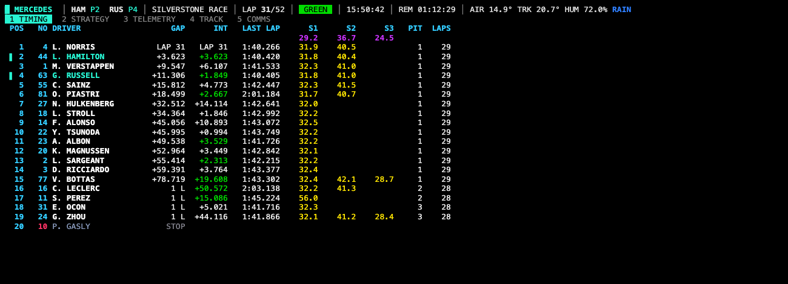
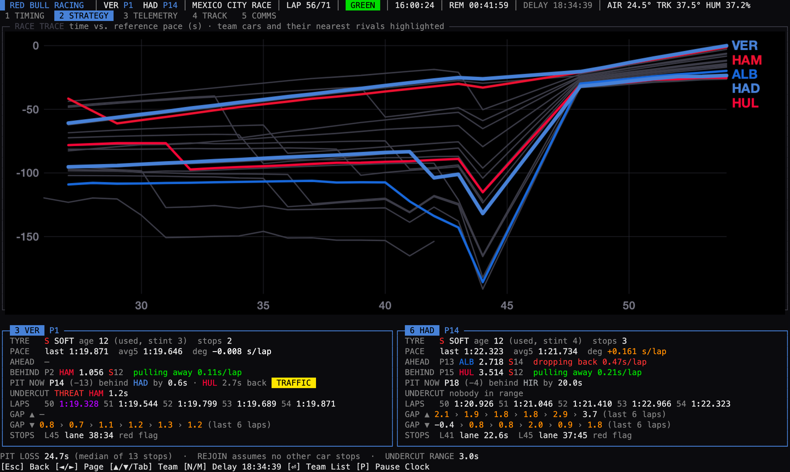
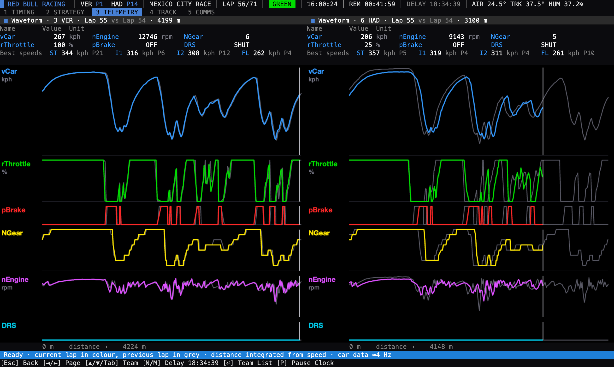
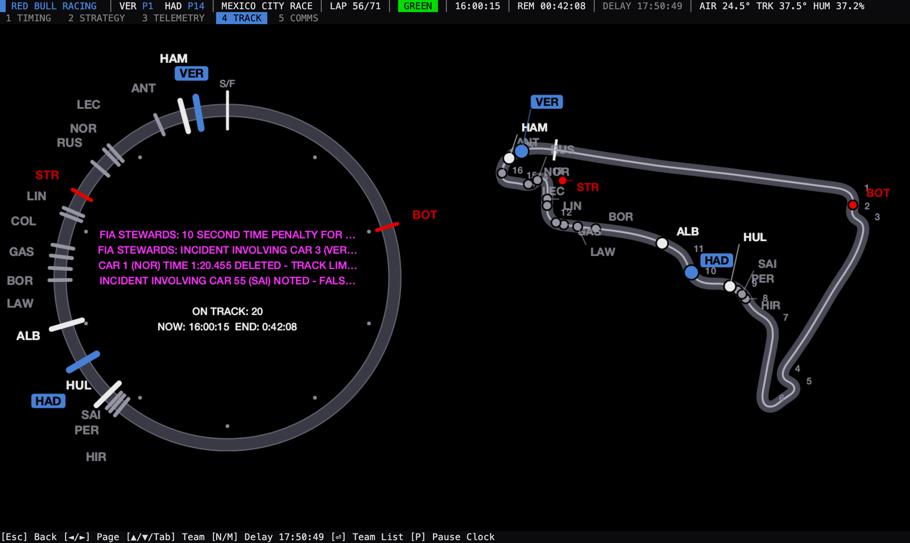
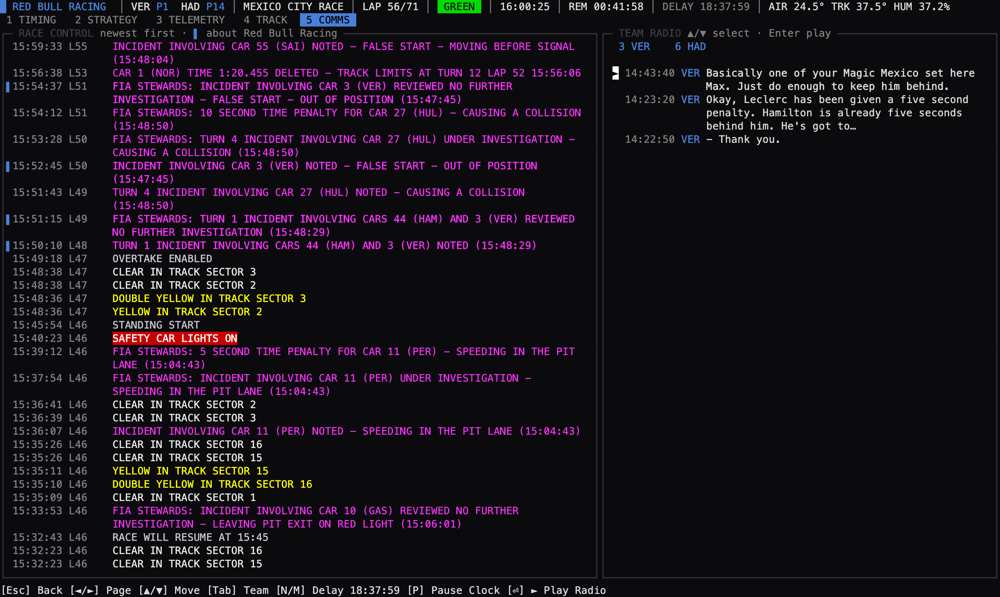

<!-- omit in toc -->
# Pitwall

**See an F1 session the way a team does.** Pick a team, and Pitwall turns the official live timing feed into a set of pit wall screens built around that team's two cars, in your terminal: the timing monitor, a strategist's view, engineer-style telemetry, a track display and the radio.



The layouts follow what you can see of real pit walls: the black FIA timing monitor with its purple, green and yellow sectors, race traces, waveform telemetry, and the lap ring and track map on team screens. Everything is computed from the public live timing feed. Teams' private data, such as tyre temperatures, fuel and energy, isn't available to anyone outside the team, so Pitwall shows what can be worked out from what F1 publishes.

<!-- omit in toc -->
## Contents

- [The pages](#the-pages)
- [Install](#install)
- [Getting started](#getting-started)
- [Keys](#keys)
- [F1 TV account](#f1-tv-account)
- [Configuration](#configuration)
- [Recording, replays and imports](#recording-replays-and-imports)
- [Building and contributing](#building-and-contributing)
- [Credits and licence](#credits-and-licence)

## The pages

Every page follows the team you picked, and its two cars are marked in the team colour. Switch team at any time.

| | Page | What's on it |
| --- | --- | --- |
| `1` | **Timing** | A faithful copy of the official timing monitor: positions, gaps and intervals, last laps, sector times in purple (session best), green (personal best) and yellow, the session-best sectors under the headers, and the clocks in yellow along the bottom. In qualifying and practice, a live **Δ BEST** column shows each car on a push lap against its own best lap, updating smoothly: purple on course for the fastest lap of all, green ahead of its best, yellow behind. |
| `2` | **Strategy** | A race trace: how many seconds each car is ahead of or behind a car lapping at the field's median pace, plotted at every sector, with every car in its team colour (each team's second car dashed) and the team's cars and their nearest rivals highlighted. Rising lines are lapping faster than the field, a sharp drop is a pit stop (marked with a dot in the new tyre's colour), and the distance between two lines is the gap between those cars. Safety cars, virtual safety cars and red flags are shaded. For each car: tyre and stint age, pace and degradation per lap, the gaps ahead and behind with their trend, where it would rejoin if it pitted now, rivals within undercut range, and its pit stops. In qualifying and practice, the race trace gives way to the lap delta: each of the team's cars' lap in progress against its own best, faster upwards, the line coloured by mini sector, with the live delta large above it. |
| `3` | **Telemetry** | Waveform traces for both cars against lap distance (speed, throttle, brake, gear, RPM and DRS), the current lap drawn over the previous one, with live values and the best speeds through each speed trap. |
| `4` | **Track** | A lap ring next to the circuit map. In races the ring is one lap in time: the leader at the top and every car behind it by its gap, with marks showing where the team's cars would rejoin if they pitted now, using the pit loss for the track status (much smaller under a safety car or VSC). In other sessions it shows where each car is around the lap. The latest race control messages are inside the ring. Drawn as a real image in terminals that support inline graphics (iTerm2, Kitty, WezTerm, Ghostty and others), and with text characters everywhere else. |
| `5` | **Comms** | Race control messages coloured by type, with the ones about the team marked, next to the team's radio. Every radio message is transcribed automatically, on your machine, and any of them can be played. |
| `6` | **Weather** | Track and air temperature, humidity, pressure, wind and rain now, with their change over the last 15 minutes and a chart of the session so far. In live sessions, the rain forecast at the circuit for the next 3 hours ([Open-Meteo](https://open-meteo.com)) and an animated rain radar around it ([RainViewer](https://www.rainviewer.com), map © [CARTO](https://carto.com) © OpenStreetMap). For strategy: which tyres the field is on, the team's tyres, and whether the last laps on wet tyres are faster than on slicks. |

All screenshots are from the 2026 Mexico City Grand Prix, lap 56 of 71, following Red Bull Racing.

**Strategy.** The race trace shows the safety car around lap 44, when the field closes up, and the red flag that followed: after the standing restart the gaps reset and the lines converge. Below it, each car's tyres, pace, gaps and their trend, where it would rejoin if it pitted now, and its stops (including the time spent in the pit lane during the red flag).



**Telemetry.** Live values and the best speeds through each speed trap, then both cars' current lap drawn over the previous one (grey), with the white cursor at each car's position.



**Track.** Where every car is around the lap and on the circuit, with the latest race control messages inside the ring.



**Comms.** Race control messages coloured by type, with the ones about the team marked, and the team's radio.



A few things worth knowing:

- **Smooth numbers.** The feed updates gaps every few seconds and car positions about once a second. Pitwall buffers the updates, fits a curve through them and redraws at about 15 frames a second, so cars glide and gaps count smoothly instead of jumping. Real jumps, like a pit stop, still show as jumps.
- **Pit loss.** The strategy page starts from the circuit's typical pit loss, switches to the time actually lost in this session's stops once there are some (comparing in- and out-laps with cars that stayed out on the same laps, so it still works when conditions change), and uses the much smaller safety car and VSC values when one is out.
- **Delay.** TV broadcasts run 30 to 60 seconds behind the live feed. The easy way to match them: press <kbd>Space</kbd> the moment the lights go out on your TV (or a qualifying session or restart goes green), and Pitwall sets the delay so it's at that start too. Or press <kbd>D</kbd> and type a delay: milliseconds (`34600`), seconds (`34.6s`) or minutes and seconds (`0:34.6`), then <kbd>Enter</kbd>. The header shows it, highlighted for a moment after you change it.

## Install

Download the executable for your system from the [latest release](https://github.com/ziofil/pitwall/releases/latest). It's a single file that doesn't need .NET or anything else installed.

```sh
# For example on an Apple Silicon Mac
curl -L https://github.com/ziofil/pitwall/releases/latest/download/pitwall-osx-arm64 -o pitwall
chmod +x pitwall
./pitwall
```

Builds are available for `osx-arm64`, `osx-x64`, `linux-x64`, `linux-arm64` and `win-x64`. The macOS builds aren't signed, so the first time macOS will ask you to allow it in System Settings → Privacy & Security.

Or run it from source with the [.NET 10 SDK](https://dotnet.microsoft.com/download):

```sh
git clone https://github.com/ziofil/pitwall.git
cd pitwall
dotnet run --project Pitwall.Console
```

Some optional features use tools you may need to install:

| Feature | Needs |
| --- | --- |
| Team radio playback | `afplay` on macOS (built in), `mpg123` on Linux, or FFmpeg's `ffplay` anywhere (always used on Windows) |
| Team radio transcription | FFmpeg, and the Whisper model: a one-time 550 MB download from the menu. Transcription runs entirely on your machine. |
| Track images | `fontconfig` on Linux (`apt install libfontconfig`) |
| F1 TV login window | WebView2 on Windows and WebKit on macOS (both built in); WebKitGTK on Linux |

## Getting started

Start `pitwall` and use the menu with the arrow keys and <kbd>Enter</kbd>. One session runs at a time: to switch to another, restart Pitwall.

1. **Watch a live session** to connect to the session happening now, or **Replay a session** to play back a recorded or imported one.
2. Pick the team to follow.
3. Move between the pages with <kbd>◄</kbd>/<kbd>►</kbd> or <kbd>1</kbd>–<kbd>5</kbd>.

To try it straight away, choose one of the two demos from the 2026 United States Grand Prix weekend in Austin: **the race**, from lights out to the chequered flag with pit stops and two virtual safety cars, or **qualifying**, Q1 to Q3 with every car's telemetry. Both are built into Pitwall, so there's nothing to download and no account needed.

More recorded sessions, from 2024, are in this repository's `Sample Data` folder. Start Pitwall with `--data-directory "/path/to/pitwall/Sample Data"` and choose **Replay a session** to play them.

## Keys

The keys for the current screen are always shown along the bottom.

| Keys | What they do |
| --- | --- |
| <kbd>▲</kbd> <kbd>▼</kbd> and <kbd>Enter</kbd> | Move through menus and lists, and choose |
| <kbd>◄</kbd> <kbd>►</kbd>, <kbd>1</kbd>–<kbd>6</kbd> | Change pit wall page |
| <kbd>▲</kbd> <kbd>▼</kbd>, <kbd>Tab</kbd> / <kbd>⇧ Shift</kbd>+<kbd>Tab</kbd> | Next or previous team on the pit wall (on Comms the arrows pick radio messages, so use <kbd>Tab</kbd>) |
| <kbd>Enter</kbd> | On the pit wall, open the team list; on Comms, play the selected radio message |
| <kbd>Space</kbd> | Sync to your TV: press it as the session goes green on screen (lights out, or a start or restart) |
| <kbd>D</kbd> | Type the stream delay (<kbd>Enter</kbd> applies, <kbd>Esc</kbd> cancels, `0` removes it) |
| <kbd>P</kbd> | Pause or resume the session clock, e.g. to line up a replay with a recorded broadcast |
| <kbd>Esc</kbd> or <kbd>Backspace</kbd> | Back |
| <kbd>Ctrl</kbd>+<kbd>C</kbd> | Back, or quit from the menu |

<kbd>H</kbd> <kbd>J</kbd> <kbd>K</kbd> <kbd>L</kbd> work in place of the arrow keys.

## F1 TV account

Since the 2025 Dutch Grand Prix, F1 only publishes some live data to logged-in F1 TV subscribers. Without an account Pitwall still works, but during live sessions you won't get:

- car positions on the Track page
- car telemetry on the Telemetry page
- pit stop times

Replays and imports of finished sessions include everything, without an account.

To log in, choose **F1 TV account** in the menu and press <kbd>Enter</kbd>, or run `pitwall login`. A window opens on the F1 login page; once you've signed in, Pitwall picks up the session token and saves it in its config file. Your password is never seen or stored. Tokens last about a week; the menu tells you when yours has expired. To log in with a different account or after changing your password, choose **Log in again** on the same screen (once per run), or run `pitwall logout`.

If the login window doesn't work on your system, you can copy the token yourself: log in at [account.formula1.com](https://account.formula1.com/#/en/login), open your browser's developer tools, copy the value of the `login-session` cookie for `formula1.com`, and add it to the config file:

```json
{
  "formula1AccessToken": "%7B%22data%22%3A%7B%22subscriptionToken%22%3A%22eyJ....."
}
```

## Configuration

The easiest way to change settings is **Settings** in the menu: every setting with its current value, changed with the arrow keys and <kbd>Enter</kbd> and saved to the config file straight away. Folders can be typed or pasted, and settings that only apply after a restart say so.

Settings can also come from the `config.json` file itself, command line options or environment variables; command line options and environment variables win over the file, and the Settings screen tells you when one is in the way. Run `pitwall info` to see what's in use. Add `"$schema": "https://raw.githubusercontent.com/ziofil/pitwall/refs/heads/master/config.schema.json"` to the file for autocompletion in editors.

| Setting | Command line | Environment variable | What it does |
| --- | --- | --- | --- |
| `dataDirectory` | `--data-directory` | `PITWALL_DATADIRECTORY` | Where sessions are recorded to and replayed from. Whisper models are stored here too. |
| `logDirectory` | `--log-directory` | `PITWALL_LOGDIRECTORY` | Where log files are written. |
| `verbose` | `-v`, `--verbose` | `PITWALL_VERBOSE` | More detailed logs. Default `false`. |
| `notify` | `--notify` | `PITWALL_NOTIFY` | Ring the terminal bell for new race control messages. Default `true`. |
| `preferFfmpegPlayback` | `--prefer-ffmpeg` | `PITWALL_PREFERFFMPEGPLAYBACK` | Play radio with `ffplay` instead of `afplay`/`mpg123`. Default `false`. |
| `forceGraphicsProtocol` | `--force-graphics-protocol` | `PITWALL_FORCEGRAPHICSPROTOCOL` | Use this inline graphics protocol instead of detecting one: `Kitty`, `Sixel` or `iTerm`. |
| `preventDisplaySleep` | `--prevent-sleep` | `PITWALL_PREVENTDISPLAYSLEEP` | Keep the display awake while Pitwall runs. Default `false`. |
| `enablePositionSmoothing` | | `PITWALL_ENABLEPOSITIONSMOOTHING` | Glide cars between position updates (they show slightly behind live). Default `true`. |
| `formula1AccessToken` | | `PITWALL_FORMULA1ACCESSTOKEN` | Your F1 TV token, normally set by logging in. |

Default locations:

| | Windows | macOS and Linux |
| --- | --- | --- |
| Config file | `%APPDATA%/pitwall/config.json` | `$XDG_CONFIG_HOME/pitwall/config.json`, or `~/.config/pitwall/config.json` |
| Data | `%LOCALAPPDATA%/pitwall/data` | `$XDG_DATA_HOME/pitwall/data`, or `~/.local/share/pitwall/data` |
| Logs | `%LOCALAPPDATA%/pitwall/logs` | `$XDG_STATE_HOME/pitwall/logs`, or `~/.local/state/pitwall/logs` |

The data and log locations can be changed with the settings above; the config file is always read from its default location.

## Recording, replays and imports

Every live session you watch is recorded to the data directory, in a folder named after the session (for example `2025_Jeddah_Race`), so you can replay it later with **Replay a session**.

You can also download finished sessions from F1:

```sh
pitwall import 2025                                          # list the meetings of a season
pitwall import 2025 --meeting-key 1256                       # list a meeting's sessions
pitwall import 2025 --meeting-key 1256 --session-key 10006   # download one
```

## Building and contributing

Pitwall is written in C# on .NET 10, with [Spectre.Console](https://spectreconsole.net) for the interface and [SkiaSharp](https://github.com/mono/SkiaSharp) for images.

- `Pitwall.Data` connects to the F1 live timing feed, records and replays sessions, and does the analysis (strategy, smoothing, circuits).
- `Pitwall.Console` is the terminal app.
- `dotnet test` runs the tests, which replay the sessions in `Sample Data` and render every page.
- [BUILDING.md](BUILDING.md) covers building the standalone executables and refreshing the generated files (config schema, circuit data).

Issues and pull requests are welcome.

## Credits and licence

Pitwall started as a fork of [undercut-f1](https://github.com/JustAman62/undercut-f1) by Aman Dhoot, which did the hard work of connecting to the F1 live timing feed, recording and replaying sessions, and drawing in the terminal. Both owe a lot to [FastF1](https://github.com/theOehrly/Fast-F1), which worked out much of how the live timing feed works. Circuit outlines and typical pit loss times come from the [MultiViewer](https://multiviewer.app) API.

Pitwall is unofficial and is not associated in any way with the Formula 1 companies. F1, FORMULA ONE, FORMULA 1, FIA FORMULA ONE WORLD CHAMPIONSHIP, GRAND PRIX and related marks are trade marks of Formula One Licensing B.V.

Copyright (C) Aman Dhoot (undercut-f1). Modifications copyright (C) 2026 Filippo Miatto; the changes are recorded in this repository's git history.

This program is free software: you can redistribute it and/or modify it under the terms of the GNU General Public License as published by the Free Software Foundation, version 3. It is distributed WITHOUT ANY WARRANTY; see the [LICENSE](LICENSE) file for details.
